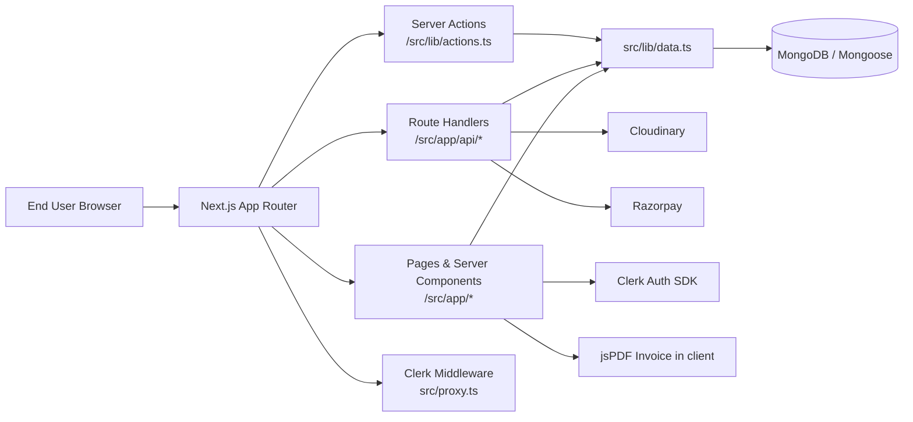
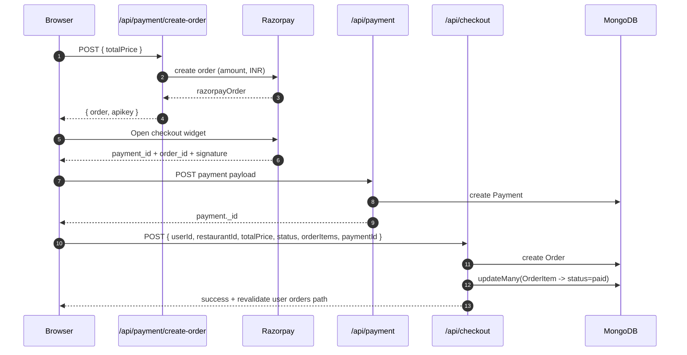
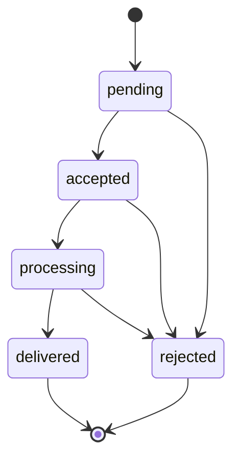
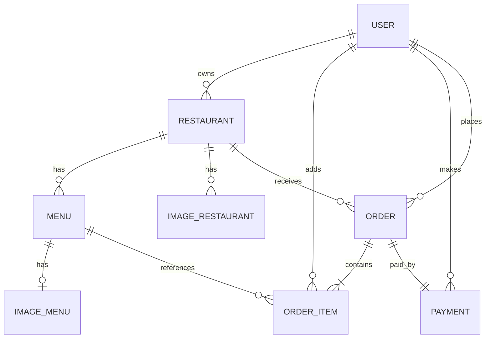

# DineSphere System Design (Current Implementation + Scale Plan)

## Executive Summary
DineSphere is a **Next.js App Router + React + TypeScript** food-ordering platform where:
- restaurant partners create and manage restaurants and menus,
- users browse menus, add items to cart, pay via Razorpay, track orders, and download invoices.

### Scope of this document
This document describes:
1. **Current-state system design** based on the code in this repository.
2. **Gaps/risks** that matter for production readiness.
3. **Target production-state architecture** and a migration path.
4. **Interview Q&A set (50 items)** grounded in this implementation.

---

## 1) Current-State Architecture

### 1.1 Tech stack and deployment model
- Frontend + backend: **Next.js 16 App Router** (server components, route handlers).
- Language: **TypeScript**.
- Auth: **Clerk** middleware + metadata roles.
- DB: **MongoDB with Mongoose**, cached connection (`src/lib/db.ts`) using DB `DineSphere`.
- Payments: **Razorpay** (`/api/payment/create-order`, `/api/payment`).
- Images: **Cloudinary** (`src/lib/cloudinary.ts`, upload routes).
- Invoice: **jspdf + jspdf-invoice-template** (`order-invoice.tsx`).
- Styling/UI: Tailwind, shadcn, Radix.
- Hosting/scheduling: **Vercel**, with daily cron in `vercel.json` hitting `/api/order-status`.

### 1.2 Component architecture (current state)


### 1.3 Major route domains
- Public/home: `src/app/page.tsx`.
- Auth routes: `src/app/(auth)/sign-in/...`, `src/app/(auth)/sign-up/...`.
- Restaurants: `src/app/restaurants/*`, create/edit/image/menu routes.
- User area: `src/app/user/[id]/*` (profile, orders, track).
- Partner onboarding: `src/app/partner/become-partner/*`.
- APIs: `src/app/api/*` (checkout, payment, users, restaurant/menu, order-item, images, order-status).

### 1.4 Authentication and route protection
- Middleware in `src/proxy.ts` protects:
  - `/restaurants/(.*)`
  - `/user/(.*)`
  - `/partner/become-partner/(.*)`
- Middleware also runs on all API routes via matcher.
- Current auth pattern: request allowed if signed-in; **most API handlers do not enforce ownership/role authorization themselves**.

---

## 2) Request and Data Flows

### 2.1 Checkout and payment flow (current implementation)
`src/components/ui/orders/checkout-button.tsx` orchestrates client-side flow.



### 2.2 Order lifecycle flow
- Cron schedule in `vercel.json`: `0 0 * * *` for `/api/order-status`.
- Current logic in `src/app/api/order-status/route.ts`:
  - finds orders older than 5 minutes (`fetchOrderOlderThan(5)`),
  - transitions: `pending -> accepted -> processing -> delivered`,
  - skips `rejected` and `delivered`.



> Current behavior caveat: because cron runs daily, any matching order may advance only once per cron run (not every 5 minutes), and GET/POST endpoint is publicly callable unless separately protected.

---

## 3) Repository/Module Mapping (Concrete Files + Symbols)

| Area | Files | Important symbols/responsibilities |
|---|---|---|
| Auth middleware | `src/proxy.ts` | `isProtectedRoutes`, `clerkMiddleware`, sign-in redirect |
| DB connection | `src/lib/db.ts` | `connect()` with global cache; DB name `DineSphere` |
| Server action | `src/lib/actions.ts` | `createRestaurant()` + Zod validation + `revalidatePath("/restaurants")` |
| Data access | `src/lib/data.ts` | `fetchUserByClerkId`, `fetchFilteredRestuarants`, `fetchAggregatedOrdersByUserId`, `fetchOrderOlderThan`, `updateOrderStatus` |
| Models | `src/lib/models/*.ts` | `User`, `Restaurant`, `Menu`, `OrderItem`, `Order`, `Payment`, `ImageRestaurant`, `ImageMenu` |
| Checkout client | `src/components/ui/orders/checkout-button.tsx` | `handleAddOrder()` payment + order creation sequence |
| Payment create-order API | `src/app/api/payment/create-order/route.ts` | Razorpay order creation, amount conversion to paise |
| Payment persistence API | `src/app/api/payment/route.ts` | stores payment payload in `Payment` model |
| Checkout API | `src/app/api/checkout/route.ts` | create `Order`, mark `OrderItem` as paid, revalidate user orders |
| Order status cron API | `src/app/api/order-status/route.ts` | status progression worker-like logic |
| Manual status update API | `src/app/api/order-status/update/route.ts` | direct order status update endpoint |
| Image APIs | `src/app/api/upload-image/*/route.ts` | Cloudinary upload/delete + image metadata persistence |
| Invoice generation | `src/components/ui/orders/order-invoice.tsx` | jsPDF invoice download in browser |
| Orders pages | `src/app/user/[id]/orders/page.tsx`, `src/app/user/[id]/orders/track/page.tsx` | `revalidate = 0`; user order/cart/track UX |

---

## 4) Domain/Data Model (Current State)

### 4.1 Core entities and relationships
- **User** (`user.model.ts`)
  - key fields: `clerkId`, `email`, `role`, profile metadata.
- **Restaurant** (`restaurant.model.ts`)
  - belongs to `User` (`userId`), contains contact/location/cuisine.
- **Menu** (`menu.model.ts`)
  - belongs to `Restaurant` (`restaurantId`), includes `name/description/price`.
- **ImageRestaurant / ImageMenu** (`image.model.ts`)
  - image metadata linked to restaurant/menu.
- **OrderItem** (`orderItem.model.ts`)
  - links `User` + `Menu`, quantity, computed line price, status (`pending|paid|cancelled`).
- **Payment** (`payment.model.ts`)
  - stores Razorpay IDs/signature and `userId`.
- **Order** (`order.model.ts`)
  - links `User`, `Restaurant`, many `OrderItem`, one `Payment`, has `totalPrice` + order status.

### 4.2 Relationship diagram


### 4.3 Current inconsistencies and schema risks
1. **Type inconsistencies**:
   - `Menu.price` is `String` in schema; order math uses numbers.
2. **Status enum mismatches**:
   - UI checks `reject` while order schema uses `rejected`.
3. **Weak typing in shared interfaces**:
   - some union/tuple definitions are inaccurate (`role: ["user", "admin"]`, etc.).
4. **Missing or minimal indexes**:
   - no explicit compound indexes for frequent queries (e.g., user pending order-items).
5. **Potential naming drifts**:
   - `websiteURL` in schema vs `websiteUrl` in DTOs.
6. **Referential integrity depends on app code**:
   - no transaction in checkout flow for order+orderItem status update.

---

## 5) API and Server-Action Responsibilities

### Server action
- `createRestaurant(userId, formData)` in `src/lib/actions.ts`
  - performs Zod validation,
  - creates restaurant,
  - redirects to detail page,
  - revalidates restaurant listing.

### API route groups
- **Users**: create/fetch/update profile and role metadata sync with Clerk.
- **Restaurant/Menu**: CRUD-like create/update for restaurant and menus.
- **OrderItem**: add, update quantity/price, delete cart items.
- **Payment + Checkout**:
  - create Razorpay order,
  - store payment record,
  - create app order and mark line-items paid.
- **Order status**:
  - cron-driven auto progression,
  - manual status update endpoint.
- **Image upload**:
  - upload to Cloudinary and persist metadata; some delete flows use DB transaction blocks.

---

## 6) Security, Validation, Caching, Cron, Failure Handling

### 6.1 Authentication vs authorization
- **Implemented**: sign-in gate on protected routes via middleware.
- **Gap**: API handlers largely trust body-provided `userId`, `restaurantId`, `status`, `price`, etc., without robust ownership checks.

### 6.2 Validation
- **Implemented**: selective Zod validation (`createRestaurantSchema`, user-create schema).
- **Gap**: many APIs have only basic null checks; no centralized request schema + response schema strategy.

### 6.3 Payment verification and idempotency
- **Implemented**: payment payload is saved and linked to order.
- **Gap**:
  - no server-side Razorpay signature verification before order finalization,
  - no idempotency key for checkout/order creation,
  - no atomic transaction for Payment + Order + OrderItem updates.

### 6.4 Image storage
- **Implemented**: Cloudinary upload helpers and dedicated routes.
- **Gap**: delete ownership checks are weak; some lookup patterns risk logical mismatch.

### 6.5 Caching/revalidation
- **Implemented**:
  - `revalidatePath("/restaurants")` on restaurant creation,
  - `revalidatePath(`/user/${userId}/orders/`)` on checkout,
  - `revalidate = 0` for key order pages.
- **Gap**: no explicit caching tier for read-heavy restaurant/menu pages.

### 6.6 Cron behavior
- **Implemented**: Vercel daily cron -> `/api/order-status`.
- **Gap**:
  - endpoint authentication/authorization is not explicit,
  - status progression cadence (daily schedule vs 5-min threshold) is behaviorally inconsistent.

### 6.7 Observability + failure handling
- **Implemented**: mostly `console.log` / `console.error` and JSON error messages.
- **Gap**: no structured logs, metrics, traces, alerts, or dead-letter strategy.

---

## 7) Current-State vs Recommended Production-State

### Current state (what exists)
- Single Next.js monolith serving UI + APIs.
- Shared MongoDB models and route handlers.
- Client-driven checkout orchestration.
- Basic middleware-based auth gate.
- Daily cron status updater.

### Recommended production state (target)
- Keep Next.js for web/UI and BFF APIs, but harden with:
  1. strict server-side authorization checks per endpoint,
  2. signed webhook/payment verification + idempotent order creation,
  3. transaction boundaries for payment/order writes,
  4. queue-based asynchronous order-state progression/events,
  5. observability stack (structured logs + metrics + tracing + alerts),
  6. rate limits/WAF and endpoint security,
  7. indexing + pagination + schema normalization.

---

## 8) Prioritized Design Gaps and Security/Reliability Concerns

### P0 (must fix first)
1. **Payment signature verification missing** before persisting/accepting payment completion.
2. **Idempotency missing** in payment->checkout flow (duplicate retries may create duplicate orders).
3. **Authorization ownership checks missing** on most mutable APIs.
4. **Trusting client-supplied prices/status/user IDs** (tampering risk).
5. **Order/payment atomicity gap** (no Mongo transaction across related writes).

### P1
6. **Cron endpoint auth** (validate secret header or Vercel cron identity).
7. **Order transition guardrails** (enforce finite-state machine + legal transitions only).
8. **Indexes for hot paths** (order tracking/cart/status scans).
9. **Pagination/filter limits** for listing routes.

### P2
10. **Schema typing consistency** (`Menu.price`, status literals, DTO naming).
11. **Centralized validation/error model** (Zod per API, typed responses).
12. **Operational observability** (request IDs, metrics, alerts, audit events).

---

## 9) Capacity Assumptions, Bottlenecks, and Scale Strategy

### 9.1 Assumptions (example planning numbers)
- DAU: 20k users, peak 2k concurrent.
- Peak read QPS: 300 (restaurant/menu browse).
- Peak write QPS: 80 (cart updates, checkout, profile updates).
- Checkout spikes during meal windows (2-4x baseline).

### 9.2 Likely bottlenecks in current design
- Single database cluster under mixed OLTP + status scans.
- No queue between payment completion and downstream order workflows.
- Route handlers doing synchronous DB/API work on request path.
- No aggressive caching for menu/restaurant browse traffic.

### 9.3 Caching strategy
- **L1**: Next.js route caching/ISR for browse pages with smart revalidation.
- **L2**: Redis for hot restaurant/menu payloads.
- **CDN**: cache static/media and transformed Cloudinary assets.
- **Do not cache** user-private cart/order APIs except short-lived edge hints.

### 9.4 Database indexing strategy (MongoDB)
Recommended indexes:
- `User`: `{ clerkId: 1 } unique`, `{ email: 1 } unique`.
- `Restaurant`: `{ userId: 1, createdAt: -1 }`, text index for name/city (or Atlas Search).
- `Menu`: `{ restaurantId: 1, createdAt: -1 }`.
- `OrderItem`: `{ userId: 1, status: 1, menuId: 1 }`.
- `Order`: `{ userId: 1, createdAt: -1 }`, `{ status: 1, createdAt: 1 }`, `{ paymentId: 1 } unique`.
- `Payment`: `{ paymentId: 1 } unique`, `{ paymentOrderId: 1 }`.

### 9.5 Async jobs/queues
Introduce queue workers for:
- payment reconciliation,
- order status progression,
- notifications,
- invoice/email dispatch,
- retries + dead-letter handling.

### 9.6 Rate limiting and abuse controls
- Apply per-IP/user limits on auth, cart, payment, and status update routes.
- Add bot mitigation, payload-size limits, and strict content-type checks.

### 9.7 Multi-region considerations
- Next.js edge for read-heavy pages, regional serverless for writes.
- Prefer geo-near primary DB write region; replicate read-only copies.
- Idempotent APIs to tolerate cross-region retry behavior.

### 9.8 SLOs (proposed)
- Availability: 99.9% monthly for core ordering APIs.
- p95 latency:
  - browse APIs < 300ms,
  - checkout API < 700ms (excluding external payment widget interaction).
- Payment/order consistency error budget: <0.1% failed/duplicate order events.

### 9.9 Disaster recovery
- Daily snapshots + point-in-time restore for Mongo.
- Runbook for payment reconciliation from gateway records.
- Tested restore drills and region failover simulation.

---

## 10) Target Scalable Architecture and Migration Plan

### 10.1 Target architecture
- **Web/BFF layer**: Next.js for UI and user-facing APIs.
- **Order service**: isolated domain handling order state machine, idempotency, transactions.
- **Payment service/integration module**: verified callbacks, signature checks, reconciliation jobs.
- **Async platform**: queue + workers + DLQ.
- **Data platform**: Mongo with explicit indexes + cache layer + analytics sink.

### 10.2 Migration plan from current monolith
1. Harden existing APIs in-place (authz, validation, signatures, idempotency).
2. Introduce queue-backed async processing while keeping existing endpoints.
3. Carve out order/payment domain modules behind internal interfaces.
4. Move high-churn workflows (status updates, notifications, reconciliation) fully to workers.
5. Optional service split once observability and contracts stabilize.

---

## 11) Interview Questions and Answers (Exactly 50)

### A) Architecture (1-8)
1. **Q:** What architecture does DineSphere use today?  
   **A:** **Today:** A Next.js monolith where App Router pages, route handlers, and server actions share one codebase and MongoDB. **Improve:** Keep BFF shape initially, then separate order/payment workflows into worker-backed domain modules.

2. **Q:** Why is App Router suitable here?  
   **A:** **Today:** It supports server components for data-heavy pages and colocated APIs. **Improve:** Add clearer domain boundaries so route handlers remain thin orchestration layers.

3. **Q:** Where is route protection enforced?  
   **A:** **Today:** In `src/proxy.ts` using Clerk middleware and route matchers. **Improve:** Duplicate critical authorization checks inside every write API.

4. **Q:** What is the biggest coupling risk in this monolith?  
   **A:** **Today:** Checkout ties client flow, payment write, and order write in one synchronous path. **Improve:** Decouple with idempotent commands and async events.

5. **Q:** How are external services integrated?  
   **A:** **Today:** Directly from route handlers/components to Razorpay and Cloudinary. **Improve:** Introduce integration adapters with retries, standardized errors, and telemetry.

6. **Q:** What request flow is most critical?  
   **A:** **Today:** `checkout-button.tsx` -> `/api/payment/create-order` -> `/api/payment` -> `/api/checkout`. **Improve:** Server-verified payment callback should gate order finalization.

7. **Q:** How does order status progression work?  
   **A:** **Today:** `/api/order-status` updates old orders through status stages. **Improve:** Move to queue-driven finite-state transitions with guards and audit trail.

8. **Q:** What architectural evolution path would you choose first?  
   **A:** **Today:** Security/reliability hardening can be done in-place. **Improve:** Then extract order/payment modules before full microservice split.

### B) Next.js + TypeScript (9-15)
9. **Q:** Where are server actions used?  
   **A:** **Today:** `createRestaurant` in `src/lib/actions.ts`. **Improve:** Use actions for trusted server workflows, but keep strict input and ownership checks.

10. **Q:** Where is cache revalidation used?  
    **A:** **Today:** `revalidatePath("/restaurants")` and `revalidatePath(`/user/${userId}/orders/`)`. **Improve:** Add a consistent cache invalidation strategy across all mutable flows.

11. **Q:** Why set `revalidate = 0` on orders pages?  
    **A:** **Today:** To show fresh user-specific order data. **Improve:** Use selective dynamic segments and lightweight polling/subscriptions for tracking pages.

12. **Q:** What TypeScript modeling issue stands out?  
    **A:** **Today:** Some interfaces use inaccurate tuple-like types for enums (e.g., role/status). **Improve:** Replace with literal unions and shared schema-derived types.

13. **Q:** How is Razorpay script loaded?  
    **A:** **Today:** `next/script` loads checkout.js in orders page. **Improve:** Add stronger runtime guards plus telemetry for script load failures.

14. **Q:** Is App Router API colocation a benefit here?  
    **A:** **Today:** Yes, it keeps feature routes close to UI. **Improve:** Add service layer abstractions to avoid business logic duplication across handlers.

15. **Q:** What TypeScript improvement helps reliability most?  
    **A:** **Today:** Handlers accept loosely typed JSON. **Improve:** Enforce Zod-validated request/response contracts and infer TypeScript types from schemas.

### C) Data Modeling + MongoDB (16-23)
16. **Q:** How are DB connections handled in serverless contexts?  
    **A:** **Today:** `src/lib/db.ts` caches Mongoose connection globally. **Improve:** Add instrumentation and timeout/retry policies by environment.

17. **Q:** What entity links represent checkout?  
    **A:** **Today:** `Order` references `OrderItem[]` and `Payment`; both reference `User`. **Improve:** Add immutable order snapshot fields for price/menu at purchase time.

18. **Q:** What schema inconsistency is risky for pricing?  
    **A:** **Today:** `Menu.price` is string while checkout math expects numeric behavior. **Improve:** Store price in smallest currency unit integer.

19. **Q:** Why are indexes important here?  
    **A:** **Today:** Queries like pending cart lookups and status scans may degrade at scale. **Improve:** Add compound indexes aligned to user/status/time access patterns.

20. **Q:** How are aggregates used for tracking orders?  
    **A:** **Today:** `fetchAggregatedOrdersByUserId` performs lookup/unwind/group across orders, orderitems, menus. **Improve:** Add projection discipline and indexed fields to reduce aggregation cost.

21. **Q:** What data consistency issue exists in checkout writes?  
    **A:** **Today:** Order creation and order-item status updates are separate operations. **Improve:** Wrap in Mongo transaction/session.

22. **Q:** How should soft deletes/history be handled for orders?  
    **A:** **Today:** Not explicit. **Improve:** Use immutable event history for state transitions and avoid destructive edits.

23. **Q:** Which model should enforce uniqueness for payment dedupe?  
    **A:** **Today:** `Payment` stores IDs without unique constraints shown in schema. **Improve:** Add unique index on gateway payment/order IDs.

### D) Authentication + Security (24-31)
24. **Q:** What is the difference between authentication and authorization in this codebase?  
    **A:** **Today:** Authentication is enforced by Clerk middleware; authorization is inconsistent per API. **Improve:** Check ownership/role in each mutating route.

25. **Q:** Which endpoints are most sensitive for authz hardening?  
    **A:** **Today:** Checkout, payment, role change, order-status updates, and image deletes. **Improve:** Require server-derived user identity and resource ownership checks.

26. **Q:** Why is trusting `userId` from client dangerous?  
    **A:** **Today:** Attackers can forge IDs to act on others' resources. **Improve:** derive actor ID from Clerk session only.

27. **Q:** What payment security control is missing?  
    **A:** **Today:** No server-side Razorpay signature verification before final order logic. **Improve:** verify HMAC signature and expected order amount/server nonce.

28. **Q:** What risk exists in status update endpoints?  
    **A:** **Today:** `order-status/update` can change status with minimal guardrails. **Improve:** enforce role-based access and finite-state transition validation.

29. **Q:** How should cron endpoints be protected?  
    **A:** **Today:** `/api/order-status` has no explicit secret check. **Improve:** validate Vercel cron headers or shared secret and deny others.

30. **Q:** Are there signs of role-check pitfalls?  
    **A:** **Today:** `checkRole` is async; incorrect usage can bypass intent if not awaited. **Improve:** centralize role guards and lint for un-awaited promises.

31. **Q:** How to reduce injection/tampering risk in APIs?  
    **A:** **Today:** many handlers do basic field checks only. **Improve:** enforce strict schema validation, allowlists, and normalized DB query builders.

### E) Payments + Orders (32-39)
32. **Q:** Describe the current payment flow in one sentence.  
    **A:** **Today:** Client opens Razorpay, then separately stores payment and creates order via APIs. **Improve:** server-confirmed payment event should atomically trigger order finalization.

33. **Q:** Where can duplicate orders come from?  
    **A:** **Today:** retries/timeouts after payment success can replay `/api/payment` or `/api/checkout`. **Improve:** idempotency keys + unique constraints + replay-safe handlers.

34. **Q:** Why should total price be server-calculated?  
    **A:** **Today:** client submits `totalPrice`, which can be manipulated. **Improve:** compute from authoritative menu prices and quantities at checkout time.

35. **Q:** How can cart race conditions happen?  
    **A:** **Today:** add-order does find-then-update logic not guaranteed atomic for concurrent requests. **Improve:** use atomic upsert/increment operations.

36. **Q:** What is the issue with daily cron + 5-minute threshold?  
    **A:** **Today:** thresholds imply frequent transitions, but scheduler runs daily. **Improve:** run at intended cadence or switch to event/worker timers.

37. **Q:** Should order statuses be auto-advanced purely by age?  
    **A:** **Today:** yes, by elapsed time and current status. **Improve:** combine with real restaurant/driver events and explicit SLA policies.

38. **Q:** What belongs in `Payment` vs `Order`?  
    **A:** **Today:** Payment stores gateway identifiers; Order references payment + items + status. **Improve:** include immutable checkout snapshot and reconciliation state fields.

39. **Q:** How would you add refunds/cancellations safely?  
    **A:** **Today:** no full refund workflow shown. **Improve:** add state machine branches, gateway refund records, and compensating transactions.

### F) Reliability + Observability (40-45)
40. **Q:** What observability exists now?  
    **A:** **Today:** mostly console logging and HTTP status responses. **Improve:** structured logs, metrics dashboards, tracing, and alerting.

41. **Q:** What key metrics should be tracked first?  
    **A:** **Today:** not centralized. **Improve:** checkout success rate, payment/order mismatch rate, API p95 latency, and cron job success/failure.

42. **Q:** How should failures in external providers be handled?  
    **A:** **Today:** immediate catch and error response. **Improve:** classify retryable errors, add backoff, circuit breakers, and reconciliation jobs.

43. **Q:** What is a critical consistency monitor?  
    **A:** **Today:** none explicit. **Improve:** detector for “payment captured but order missing” with automatic repair workflow.

44. **Q:** Why add request correlation IDs?  
    **A:** **Today:** tracing cross-route payment flow is manual. **Improve:** correlation IDs link create-order, payment save, checkout, and status transitions.

45. **Q:** How do you make cron jobs safer operationally?  
    **A:** **Today:** endpoint can be manually invoked and mixed with cron behavior. **Improve:** authenticated trigger + idempotent batch processing + run history logging.

### G) Scaling (46-50)
46. **Q:** What should scale first: app servers or database design?  
    **A:** **Today:** both matter, but DB/index/query shape is the first limiting factor. **Improve:** optimize schema/indexes and cache before brute-force compute scaling.

47. **Q:** How would you scale restaurant/menu reads?  
    **A:** **Today:** direct DB reads via route handlers/data helpers. **Improve:** CDN + ISR + Redis caching for popular restaurant/menu payloads.

48. **Q:** When would you split services?  
    **A:** **Today:** monolith is acceptable for early stage. **Improve:** split when order/payment domain complexity, team ownership, or traffic patterns justify it.

49. **Q:** What multi-region strategy fits DineSphere?  
    **A:** **Today:** single-region behavior is implied. **Improve:** edge read distribution + primary write region + idempotent write retries.

50. **Q:** What is the long-term scaling posture?  
    **A:** **Today:** functional monolith with foundational integrations. **Improve:** secure, observable, queue-driven architecture with explicit domain boundaries and SLO-driven operations.

---

## 12) Practical Scaling Roadmap (Phase 0 -> Phase 4)

### Phase 0 (Immediate hardening)
- Add server-side payment signature verification.
- Add API-level ownership/role checks.
- Stop trusting client-provided totals/status/user IDs.
- Add idempotency keys and unique payment constraints.

### Phase 1 (Data and correctness)
- Normalize schema typing (price/status/DTO names).
- Add transactions for checkout critical path.
- Add indexes + pagination on read endpoints.
- Protect cron endpoint with explicit auth.

### Phase 2 (Operational maturity)
- Structured logging, metrics, tracing, alerts.
- Reconciliation jobs for payment/order mismatches.
- Better error taxonomy and retry/backoff patterns.

### Phase 3 (Performance and throughput)
- Introduce Redis caching for browse and search patterns.
- Move status progression and notifications to queue workers.
- Add rate limiting and abuse controls.

### Phase 4 (Distributed scale)
- Domain split for order/payment services if needed.
- Multi-region read scaling and failover drills.
- SLO/error-budget governance with disaster recovery automation.

---

## 13) How I would explain this project in an interview
DineSphere is a Next.js + TypeScript full-stack food ordering platform using Clerk auth, MongoDB, Razorpay, and Cloudinary. Today it works as a monolith with App Router pages plus API routes for ordering and payments. The strongest engineering story is the migration path: first harden payment integrity, authorization, and transactional correctness; then add observability, indexing, and queue-based workflows; and finally evolve into a scalable, resilient architecture without rewriting everything at once.

---

## 14) PDF Generation (Reproducible)
Generate the PDF from this markdown:

```bash
python scripts/generate-system-design-pdf.py
```

This command reads `docs/system-design.md` and writes `docs/dinesphere-system-design.pdf`.
